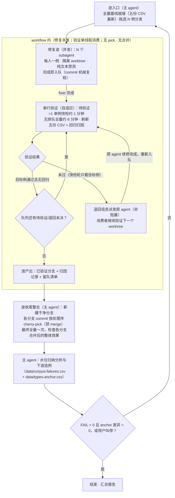

# Agent 基础要求

## 协作规范

- git commit 只在用户明确指示时执行（如「提交一下」）；文档或代码修改后只落盘，不主动提交
- 主分支（main）不频繁小步提交，提交时机与粒度由用户决定
- **产出整合纪律**：workflow/subagent 修复完成后，整合一律新建干净分支 + 逐 commit cherry-pick（或等价 rebase 线性化），禁止 merge commit——merge 历史混乱、无法人工识别每个改动的来源与顺序。主仓合入同口径：分支上的修复 commit 保持线性可追溯。

### 语料修复飞轮

主 agent 是循环驱动者与判定口径持有者：全量校验在 workflow 内以 world.run 于各 worktree 上**串行**执行（命令集经用户确认），波收尾线性整合与水位分析在主 agent；subagent 全程**纯文本**（隔离 worktree 内只修**一个用例**，禁构建禁测试，输出独立 commit）。

**修复模型**：GLM-5.3-Flash · max 思考档。

**架构约束**：一个 workflow = **修复波 + 波内串行验证**两段。修复波是唯一并发段——N 个并发位 = N 个用例（并发上限由提交参数 `max_concurrency` 控制，协议当前 8，超出者排队滚动进入），每个 subagent 只修一个用例，**完成即入队**（`git rev-list` 机械复核 commit 数，零 commit 直接留队，有 commit 立即进验证队列，不设整波栅栏）；验证段串行——单线程消费队列，一次只跑一个校验命令，**自适应**：待验证队列长度 >1（有排队积压）走单例快检（`cargo xtask verify --cases`，约 1 分钟，不感知跨例回归），无排队走全量（`TSOX_POOL=1 cargo xtask verify`，含相对波起点回归归因）。回归退回**非阻塞**：未过时把退回信息作为后续 ask 派发给原 agent（同名 agent 上下文延续）后，消费者继续验证下一个 worktree，修完自动重新入队复验；**退回无固定次数上限**，停止由用户叫停或 amend 控制，留队仅「无 commit」一种来源。workflow 脚本入库 `.zcode/workflows/corpus-fix-wave.dwf.ts`（每波改 `WAVE`/`CASES` 常量按名运行）。波收尾的线性整合与下波分发在主 agent，不在 workflow 内跨波循环。

- **选例**：从 `data/corpus-failures.csv` / `data/types-anchor.csv` 挑选 N 例（排除在飞/留队用例，同族错开或取代表例）启动单波 workflow。**波例数 6、并发 4**（2026-10-05 用户拍板：fix40/43 两波 20 例整合均因 HEAD 并集解吞掉修复而失效，fix44 叫停后 6 例小批次验证成功——仅 1 冲突、修复全部存活；每簇取 1 例进一步压冲突面）。**双波并行与 plan 配比**（2026-10-05 用户拍板）：支持同时发两个 workflow 分治同一批选例（如 A 取 1-8、B 取 9-12），各用不同修复策略与 provider：
- Plan A（先规划后动手）：并发 6，provider `account:bigmodel-individual-coding-plan/GLM-5.3-Flash$max`
- Plan B（根因定位优先，先出双侧源码行号对照表）：并发 2，provider `account:bigmodel-start-plan/GLM-5.3-Flash$max`
并发与 provider 可从 GUI 实时调整（不 stop 不重启）；波收尾各自独立整合再合入。
- **数据体系（`data/` 目录 CSV，`cargo xtask verify` 全量后同步刷新）**：
  - `data/corpus-failures.csv` / `data/corpus-skips.csv`——FAIL 全量 / SKIP 全量（水位与选例出发点）；
  - `data/rust-trace.csv`——Rust 侧 FAIL 对齐函数调用序列（**不进 git**；原始 trace 在 `/tmp/tsox-verify/<runid>/fn-trace/`）；
  - `data/rust-types.csv`——Rust 侧**全量** .types 输出（**不进 git**；原始 .types 在 `/tmp/tsox-verify/<runid>/types/`）；
  - `data/types-anchor.csv`——每例 .types **首分歧锚点**（本地 vs Go reference 的第一个类型分歧行+两侧上下文）；
  - `data/stack-diff.csv`——两侧执行栈差集（go_only / rust_only，Go 侧取一次性快照 `data/corpus_go_trace.csv`）；
  - `data/corpus-failures.base.csv` / `data/corpus-skips.base.csv`——波起点快照，归属 base 检出（`--base-dir` > `TSOX_BASE_DIR` > main 分支 worktree 自动探测），非 base 检出内只读；
  - Go oracle 一次性数据 `data/corpus_go_trace.csv` / `data/corpus_go_types.csv`。
- **xtask 验证工具（2026-10-15 起，旧 wave_verify 链已于 2026-10-16 退役）**：`cd <worktree> && cargo xtask verify`——执行现场即验证目标（CWD 探测 worktree），构建、worker 执行、data/ 产物全在该 worktree。参数 `--jobs`（默认 12，SMT 拐点实测）/`--mem-mb`（默认 4096）/`--case-timeout-secs`（默认 30）/`--round-timeout-secs`（默认 2400）；单例/多例用 `--cases <file>`（一行一个 key，`#` 注释），缺省全量。护栏：全局 flock（`/tmp/tsox-verify.lock`）+ 磁盘门槛 15GiB + worker 进程 RLIMIT_AS/nice 由父进程下发。判定输出 verdict.json 与 stdout `VERDICT_JSON=` 单行（workflow 侧解析契约，迁移时对接）；归因语义沿旧口径：new FAIL 不含 skip→fail 翻转、超时 SKIP 分桶噪声不计回归、fixed 同口径。运行归档 `/tmp/tsox-verify/<runid>/`（run.log/verdict.json/fn-trace/types/shards），保留 14 天 + 最近 20 轮自动清扫，`cargo xtask clean` 手动全清。语料 harness 逻辑在 `crates/tsox-harness`（测试目标 `tests/corpus` 为其薄壳，libtest 入口与旧行为等价）。**旧链退役（2026-10-16）**：`tools/wave_verify.sh` 与七个 CSV 生成脚本(corpus_csv_export/types_csv/types_anchor/types_one_diff/fn_trace_csv/stack_diff/cut_test_shards/corpus_one)已删除,旧根 CSV(results/skips/base/stack_diff/types_anchor)已退役;保留 `corpus_go_trace.csv`/`corpus_go_types.csv`(oracle 一次性数据)与 `func_alignment.csv`。`.dwf.ts` workflow 尚未迁移 xtask,迁移前飞轮验证不可用(主 agent 可直接 `cargo xtask verify` 代跑)。分片改读 `/tmp/tsox-verify/<runid>/shards/`。
- **波内串行验证（workflow 内，单线程消费队列）**：fixer 完成→commit 机械复核→有 commit 即入队。验证**自适应**：待验证队列长度 >1（有排队积压）走单例快检（`cargo xtask verify --cases <file> --jobs 4`：只跑目标例 + anchor 上下文，约 1 分钟，不感知跨例回归）；无排队走全量（`TSOX_POOL=1 cargo xtask verify --jobs 12`，约 2 分钟，自动刷新 data/ 水位 + 相对波起点归因）。每个 worktree 分支只含本例改动，全量轮**回归天然归因到该分支的 commit**（N 个改动不混批）；编译失败同样逐例暴露（机械错可最小修复并标注，逻辑错原样记录）。**退回（非阻塞）**：判定未过把退回信息（全量轮：新 FAIL 清单 + 水位；快检轮：单例基线 diff）作为后续 ask 派发给该 worktree 的原 agent——同名 agent 上下文延续——消费者继续取下一个 worktree，原 agent 续修追加 commit 后该例自动重新入队复验；**退回无固定次数上限**（停止由用户叫停或 amend 控制），留队仅「无 commit」一种来源，随波产出交主 agent 入留队池。验证脚本带资源护栏：构建 `-j 12` + 每进程 `ulimit -v 8GB` + `nice -n 10` + 内部超时（单例 600s / 全量 1200s，外层 world.run 900s / 3600s），语料执行 `ulimit -v 4GB` + `nice`。**波收尾整合（主 agent，workflow 外）**：波收尾做合并态最终全量复核与数据快照；零回归未收敛留队分支的整合仍由主 agent 按保守口径（cherry-pick 线性化，回归携带分支不整合）。**串行逐步合并（2026-10-07 用户拍板，fix54 起）**：验证阶段即合并——队首分支通过全量验证（errors PASS + 无回归 + anchor 消失）后，workflow 直接将其 commit 逐笔 cherry-pick 合入 ts2rust-port；每次合入使基线前移，消费器在每例验证前检测基线前移，对受影响分支直接退回 rebase（不跑本轮验证、**不计入退回次数上限**），即合入后队列其余分支全部回炉新基线重修重验；验证失败打回原 agent 续修并检查下一个。合入冲突不阻断队列（保留分支交主 agent 手合）。该机制使每支的末次验证必然建立在全部已合入分支之上，跨分支交互（如 fix53 批次合并暴露的栈溢出交互与末轮回归误并）在波内即暴露。**最终全量发现大量回归时的两步归因**：①查运行归档 `/tmp/tsox-verify/`（verdict.json 含 completed/total=6820 即全量轮），得出各 worktree 有无完整全量记录，波内拿到全量轮的分支直接引用其归档回归数据；②对无完整全量记录的 worktree 逐个**串行**跑全量（`TSOX_POOL=1 cargo xtask verify --base-dir <主仓>`，对波起点 base 快照输出该分支新增 FAIL/SKIP），单 worktree 直跑保证归因纯净——回归只能来自该分支自身 commit。base 快照与各 worktree 保留至归因完成后方可清理。
- **回归处置**：某 commit 引入回归时**只记录归因、不当场修**——按「回归-改动相关分析」锁定到该 commit（真回归 vs 假绿暴露、波及例清单），该 commit 可保留或回退由归因结论决定；修复动作经**波内非阻塞退回**原 agent 在原 worktree 续修（见架构约束），不再顺延到后续波次。
- **subagent 契约（单例分片）**：隔离 worktree；只读 repo / Go oracle（`/home/cqh/workspace/typescript-go`）/ 分片失败信息（三层锚点：.types 首分歧 → 错误 diff → 执行栈对照，见 `/tmp/tsox-verify/<runid>/shards/` 与 `data/rust-trace.csv`）；禁止任何 cargo/编译/测试/探针；禁止 skip/改断言/改基线消错与空壳实现；符号不存在三选一（grep 等价接线 / 按 Go 最小真实实现 / 保留错误记交接）；按根因独立 commit（只 add crates/ 生产路径）；汇报 rootCause（双侧源码行号）与**函数变更表**（缺表打回）。时限为期望值（目标 30 分钟级，非硬截点），单根因约 10 分钟无进展换思路或收尾交接。
- **异常路由**：深水例（长期不收敛）由用户叫停波次或 amend 处置，不自动留队；新增 skip / 基线变更必须人工确认。
- **收敛**：FAIL = 0 + 回归归零 + `data/types-anchor.csv` 差异抹平（全量 .types 与 Go reference 零首分歧，含已 PASS 用例的隐藏类型分歧）+ 汇总报告。

函数靠齐追踪表：`python3 tools/gen_func_alignment.py` 生成 `data/func_alignment.csv`（静态抓取 Go/Rust 两侧全部函数名，camelCase↔snake_case 由脚本归一为 `norm_name` 排序键，单表左右对照）。该表与仓库根 CSV 同为 subagent 只读。

**靠齐判定纪律（不可违反）**：我们在做的是**按名称匹配迁移，只以 `data/func_alignment.csv` 表格数据为准**。不得随意以其他方式（报告声称、语义判断、探针观察等）认为匹配完成。

## 代码规范

### 代码拒绝注释

代码自身的命名和结构应当足以表达意图。

**禁止**：
- 解释"这段代码做了什么"的注释，应通过提取有意义的函数名/变量名来表达
- 解释"为什么"这样做的注释，应写到外部文档（`docs/` 下的设计文档、issue、commit message），不要留在代码里
- 逐行翻译式注释

**要求**:
- 注释掉的死代码，直接删除
- 引用外部规范/issue/RFC 的标记（如 `// RFC 1234`），放到外部文档
- 模块/文件顶部的 `//!` 职责说明，模块职责应从命名和文件夹结构推测
- 公开 API 的 doc comment（`///`），除非是供外部调用的框架/库（crate 发布到 crates.io 或被 workspace 外引用），否则不加

### 单文件不超过 300 行

任何 `.rs` 源文件（不含测试文件）超过 300 行时，必须拆分为子模块。

拆分原则：
- 按职责拆分到 `mod.rs` 子目录，而非机械地按函数切分
- 公开 API 在 `lib.rs` / `mod.rs` 统一 re-export（`pub use`），保持对外接口不变
- 测试文件（`tests/` 下的集成测试）不受此限制

## 测试规范

任何测试都不与源码文件混放。不采用内联测试（`#[cfg(test)] mod tests`）。

- **所有测试**：放在 crate 根的 `tests/` 目录下（独立文件），只测公开 API
- 需要测私有逻辑时，通过 `#[doc(hidden)] pub` 或将待测逻辑提取为独立模块/crate 暴露出来，而非内联测试访问私有成员
- **不要**把集成测试写在 `examples/` 目录里冒充测试，examples 是可运行的示例程序，不是 `cargo test` 的一部分

**`tests/` 根下的每个 `.rs` 都是一个独立 binary（独立链接目标），只放少量真正的独立测试入口。**

批量生成型测试（语料用例、fourslash 等成百上千条同框架用例）必须收敛为单一集成测试目标：

- 形态：`tests/<套件名>/main.rs` 作为该套件唯一入口（`tests/` 子目录不会自动成为 binary），用例文件放在入口的子目录里，入口统一 `mod`/`include!` 声明
- 用例与模块清单由生成器一并产出并维护，手工不逐个增删
- 禁止在 `tests/` 根下平铺生成大量单用例 `.rs` 文件

测试分层：
- 纯逻辑（序列化、解析、状态转换）→ `tests/` 下的单元测试文件
- 跨模块/进程内集成（HTTP 路由、WS 信令、WebRTC 建立）→ `tests/` 集成测试
- 批量语料/生成型用例 → `tests/<套件名>/` 单一目标（见上）
- 多进程编排（需要启动外部服务，无浏览器）→ CI 中的集成 job
- 浏览器 UI 端到端 → 独立的 Playwright 工程

### 测试运行规范

- Rust 全量/批量测试：`(ulimit -v 4194304; cargo test --release --no-fail-fast)`，内存限制必须保留（RLIMIT_AS 4GB——2026-09-29 用户指示由 8GB 降档：语料 worker 每用例独立进程实际峰值远低于此，fourslash OOM 的瓶颈是套件累计驻留而非单限值，降档防宿主内存压力）；release 相对 debug 有 5 倍执行提速（fourslash 4471 用例单二进制约 60s，构建成本远小于收益）；**全量语料必须加 `TSOX_SUBMODULE_LIMIT=0`**——runner 默认只跑前 1000 例，日志计数出现 `#/1000` 即被截断，`#/6820` 才是全量
- Rust 单条用例调试迭代：debug 构建可接受（编译快，单条秒级），同样保留内存限制
- Go oracle：`GOMEMLIMIT=4GiB go test -count=1 ./...`（Go 运行时对 RLIMIT_AS 敏感，用软限）
- 全量语料的内存护栏脚本 `tools/fourslash_shard.py`（分片 + 单线程 + RSS 采样 + 断点续跑），批量回归异常排查时启用

超限的表现是进程被提前杀死或输出不完整；此时按内存/死循环根因排查（受控探针测斜率、变体二分）。

- 语料全量验证走 `TSOX_POOL=1 cargo xtask verify --jobs 12`(全量跑自动刷新 `data/` 七份水位 CSV 并按需更新 base 快照;`--cases` 抽样跑不触碰 data/,报告只落运行归档)

## 文档规范

仓库文档按位置分层，各自回答一类问题，**做什么、怎么做、为什么不做**：

| 位置 | 类型 | 内容 |
|---|---|---|
| 仓库根 `README.md` | 导航 | 项目职责、功能模块、开发命令、目录结构、指向 `docs/` 的链接 |
| 仓库根 `roadmap/` | 做什么 | 规划中的方向、待办、设计构想（未来时态） |
| 仓库根 `todos/` | 做什么（待办粒度） | 代办事项文档：具体的、可跟进的待办项；方向性规划仍在 `roadmap/` |
| 仓库根 `docs/` | 怎么做 | 设计文档、架构说明、协议约定：机制、流程与权衡论证 |
| 仓库根 `decisions/` | 为什么不做（含为什么这样做） | 已拍板决策记录（ADR）：结论 + 理由；**否决项必须在此留档且细节自包含**（不写「详见 docs」）；引用方向为 `docs/` → `decisions/`，反向不成立 |
| 仓库根 `issues/` | 已知问题 | 设计债、open questions（不含未来规划，不含已拍板决策） |

「不做」是一等决策：拒绝一个方案与采纳一个方案同等留档，没有记录的「不做」会被反复重新提议、反复重新论证。

文档不是 API 参考，具体实现细节由代码承担。

文档的内容与拆分按 [Divio 文档体系](https://docs.divio.com/documentation-system/) 处理，每份文档明确自己属于哪个象限，不混杂：

| 象限 | 回答的问题 | 特征 | 归属 |
|---|---|---|---|
| 教程（tutorials） | "带我走一遍" | 面向学习，可照做的完整过程，保证结果 | QuickStart、入门示例 |
| 操作指南（how-to） | "怎么完成某件事" | 面向目标，假设已有基础，步骤化 | 部署指南、配置说明 |
| 参考（reference） | "它是什么/有哪些" | 面向查阅，准确、完整、结构化，无叙事 | API 表、协议/消息格式、配置项 |
| 解释（explanation） | "为什么是这样" | 面向理解，讲设计动机、权衡、替代方案 | 设计文档、架构总览、决策记录 |

拆分原则：

- 一份文档一个象限；"设计 + 操作步骤"混在一起时拆成两份互链；
- 表结构等数据定义单独成参考档（`*-schema.md`），设计档只讲机制与流程，不放 schema 定义；
- 单份文档不超过 150 行：超长时**优先分离 mermaid 图表**到同名 `.diagram.md` 文件（与正文同目录，正文原位留一行指针），仍超长再按象限拆分；
- 变更记录不入正文：每份文档的变更单独记在同名 `.change.md` 后缀文件（`foo.md` → `foo.change.md`，与正文同目录），按同名约定发现，正文不留指针。

写作规范：

- 安全类内容先写后果，会造成什么危害，再写机制与方案；
- 未经人工协商的推测内容不入档，宁可留〔待补〕占位，不写推测性草案；
- 流程描述一律用 mermaid 图（flowchart / sequenceDiagram），不用纯文本箭头或字符画；
- 不用破折号等书面转折符号，用逗号、冒号或拆句表达；
- 跨文档引用精确到小节：目标小节标题上方加 `` 锚点，引用写作 `文档.md#短名`，不用 § 编号裸文本；
- 文档头部只保留一行版本号（`> 版本：vX.Y · 日期`，须与同名 `.change.md` 最新版本一致）；象限、关联、背景等说明不入头部，象限归属见 `docs/README.md` 导航，变更背景记入 `.change.md`，必要的前置说明写入正文。
